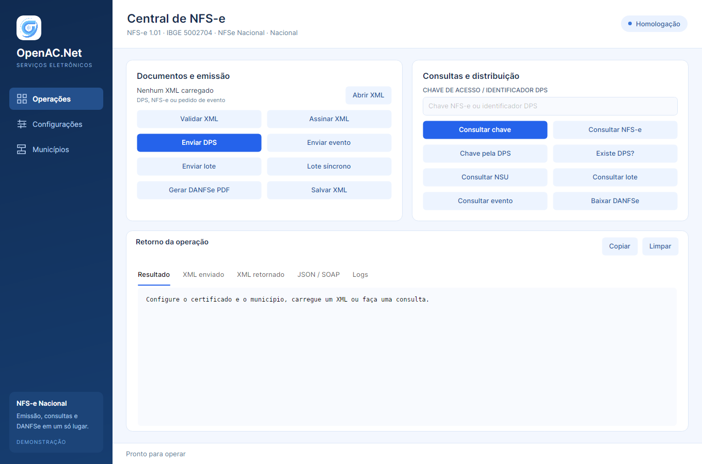
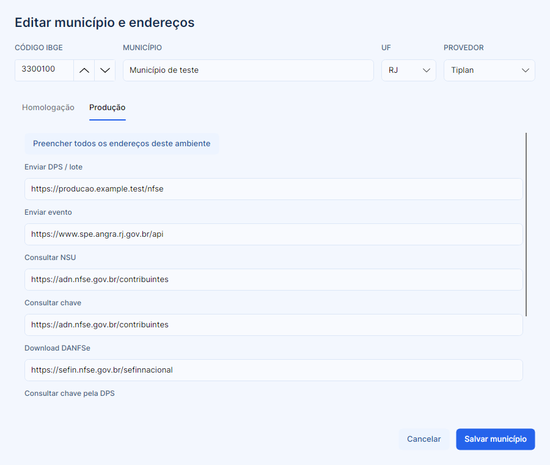

# Demo Avalonia do OpenAC.Net.NFSe.Nacional

Aplicação desktop em .NET 8 e Avalonia 12.1.4, com o tema azul e a navegação do demo
OpenAC.Net.CTe. Funciona em Windows, Linux e macOS com o runtime .NET 8 instalado.

A partir de `src`:

```bash
dotnet run --project OpenAC.Net.NFSe.Nacional.Demo
```

## Configuração

Em **Configurações**, informe o certificado PFX/P12 e a senha, ou o número de série de
um certificado com chave privada no repositório do usuário. Configure o código IBGE,
o CPF/CNPJ e a inscrição municipal do prestador, a versão e o ambiente.
O demo inicia em **homologação**, versão **1.01**.

Os schemas são copiados para a saída com a biblioteca. Deixe o campo de schemas vazio
para usar automaticamente `Schemas/1.00` ou `Schemas/1.01`, conforme a versão selecionada.
Para provedores com schemas próprios, selecione a pasta correspondente.

**Salvar configurações** grava `nfse.config` no diretório local de dados do usuário,
em `OpenAC.Net/NFSe.Nacional.Demo`. O caminho completo aparece na tela.
A senha só é persistida quando **Lembrar senha neste usuário** estiver marcado;
a gravação usa o mesmo formato criptografado do demo CTe.

## Operações

- Abrir um ou vários XMLs de DPS, NFS-e ou pedido de registro de evento (`pedRegEvento`).
- Validar XML contra os schemas, assinar DPS/eventos e salvar o XML carregado.
- Enviar uma DPS, um evento, um lote assíncrono ou um lote síncrono.
- Consultar distribuição por NSU ou chave, chave pela DPS e existência de DPS.
- Consultar lote por protocolo, NFS-e por chave/DPS e eventos por tipo e sequência.
- Baixar DANFSe do serviço ou gerar PDF localmente a partir de um XML de NFS-e.

Para cancelamentos e outros eventos, carregue o XML `pedRegEvento` correspondente e use
**Enviar evento**. Para envio em lote, carregue apenas XMLs de DPS e informe o número do lote
nas configurações. A versão e o ambiente dos documentos devem coincidir com a configuração.
As operações disponíveis dependem da implementação do provedor; eventuais limitações são
apresentadas na área de retorno.

As abas mostram resultado, XML enviado, XML retornado, JSON/SOAP e logs.
Durante uma operação, o demo bloqueia novas chamadas na mesma instância e permite
**Cancelar operação**. O tempo limite configurado é aplicado às chamadas dos serviços.
Ao fechar durante uma operação, a aplicação solicita cancelamento e aguarda a conclusão.

## Municípios e endereços

A tela **Municípios** permite buscar por nome, código IBGE, UF ou provedor, cadastrar um
município e editar os existentes. O editor tem abas de **Homologação** e **Produção**,
com os oito tipos de URL da biblioteca. É possível preencher todos os endereços de um
ambiente com uma única URL base. Informe as URLs base utilizadas pelo provedor;
a biblioteca acrescenta as rotas das operações.

**Salvar município** valida código duplicado, nome e URLs e persiste o catálogo local
`Municipios.nfse`, ao lado de `nfse.config`. **Cancelar** descarta as alterações do editor.
**Usar município** aplica o código IBGE às configurações e salva a seleção.

**Importar Municipios.nfse** substitui o catálogo local pelo arquivo selecionado;
**Exportar catálogo** permite compartilhar o catálogo editado. Ambos usam o formato
nativo da biblioteca. O serviço de código `-1` é o padrão nacional, usado automaticamente
quando não há configuração específica para o município informado.

## Testes offline

Com o SDK .NET 10, conforme `global.json`:

```bash
dotnet test --project OpenAC.Net.NFSe.Nacional.Demo.Tests/OpenAC.Net.NFSe.Nacional.Demo.Tests.csproj
```

Os testes usam TUnit e Avalonia Headless. Exercitam navegação, pesquisa, persistência de
configurações, edição de endereços por ambiente, descarte de alterações, validações e
conclusão/cancelamento de consultas simuladas. Não exigem certificado nem transmitem
notas. A variável `OPENAC_DEMO_SCREENSHOTS` define uma pasta opcional para capturas das telas.




